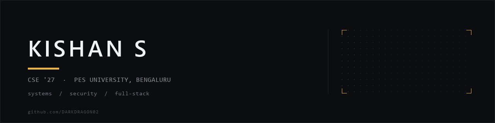

 

Final-year Computer Science student at PES University, Bengaluru. I work one layer below the framework: a container runtime that enforces memory limits from inside the kernel, and an encryption layer that forced me to rewrite my own README about what "encrypted" actually promises.

`Bengaluru, India` &nbsp;·&nbsp; `B.Tech CSE, 2023–2027`

---

## Selected work

| | Project | What it does | Built with |
|:--:|---|---|---|
| 01 | **[container-runtime-monitor](https://github.com/DARKDRAGON02/container-runtime-monitor)** | Process isolation through `clone()` with PID, UTS and mount namespaces, plus a loadable kernel module that samples RSS via `get_mm_rss()`, warns at a soft limit and `SIGKILL`s past a hard one. | `C` · `Linux` · `kernel module` |
| 02 | **[Secure-Vault-AI](https://github.com/DARKDRAGON02/Secure-Vault-AI)** | AES-256-GCM on both legs — the browser encrypts with a fresh IV through Web Crypto, the Node relay decrypts to call Gemini and re-encrypts the reply. Not E2EE, and the README says why. | `TypeScript` · `Next.js` · `Web Crypto` |
| 03 | **[swara-maternity-clinic](https://github.com/DARKDRAGON02/swara-maternity-clinic)** | Booking system built for a working maternity clinic and live in production, with a zero-login email-driven admin flow so staff manage no passwords. | `React` · `Vite` · `Express` · `Tailwind` |
| 04 | **[E-Commerce](https://github.com/DARKDRAGON02/E-Commerce)** | MERN storefront where every protected route verifies a Firebase ID token server-side, so no password is stored anywhere. Nightly cron closes out overdue deliveries. | `MongoDB` · `Express` · `Firebase Auth` |
| 05 | **[suspended-sediment-particle-size-prediction](https://github.com/DARKDRAGON02/suspended-sediment-particle-size-prediction)** | Random Forest vs SVR vs XGBoost benchmark with reproducible runs, feature-importance analysis and an R² comparison. | `Python` · `XGBoost` · `scikit-learn` |

## Stack

| | |
|---|---|
| **Languages** | `C` · `Python` · `TypeScript` · `JavaScript` |
| **Systems** | Linux namespaces · `clone()` · kernel modules · OpenFlow · Mininet |
| **Security** | AES-256-GCM · Web Crypto API · JWT · Firebase Auth |
| **Web** | React · Next.js · Node.js · Express · Tailwind CSS · MongoDB |
| **Data** | scikit-learn · XGBoost · pandas · NumPy |
| **Tooling** | Git · GitHub Actions · Vercel |

## Also worth a look

- **[flow-timeout-manager](https://github.com/DARKDRAGON02/flow-timeout-manager)** — SDN experiment on OpenFlow rule lifecycles using a Ryu controller and a Mininet topology.
- **[SE-CLASS-STUFF](https://github.com/DARKDRAGON02/SE-CLASS-STUFF)** — pytest practice: unit/integration split, a marker taxonomy, and pylint, bandit, black and coverage wired into the toolchain.
- **[DAA-Project](https://github.com/DARKDRAGON02/DAA-Project)** — Dijkstra, rod cutting and maximum subarray in C, with complexity analysis.

## Currently

- Finishing B.Tech CSE at PES University (2027).
- Open to new-grad and internship roles in systems, security, or infrastructure-adjacent engineering.
- Contributing to a shared codebase — 4 PRs merged into `se-mini-project-t16/railway-reservation-system` covering registration, JWT login, account lockout and e-ticket generation.

---

Best reached at <b>kishan.sangram@gmail.com</b> · <a href="https://www.linkedin.com/in/kishan-s-72b250334/">LinkedIn</a> · <a href="https://github.com/DARKDRAGON02">GitHub</a>
